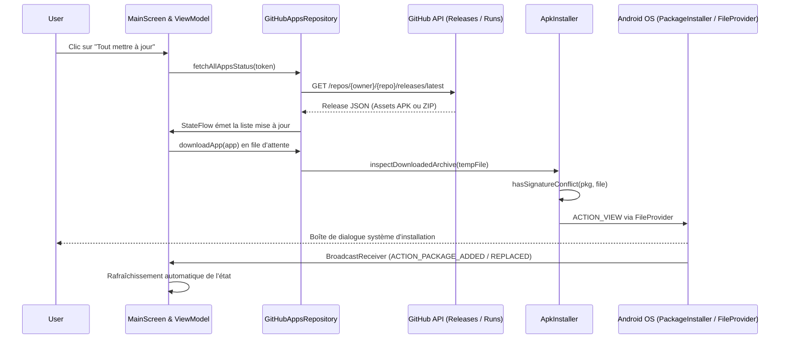

# Spécifications Fonctionnelles & Techniques Détaillées — InstallAPK

> **Application** : InstallAPK (GitHub Android Updater & Package Manager)  
> **Package ID** : `fr.installapk.app` | **Dépôt** : `Geoff1805/InstallAPK`  
> **Emplacement local** : `G:\Mon Drive\05_Dev\InstallAPK`  
> **Version actuelle** : `v1.0.53` | **Statut** : Spécification détaillée certifiée

---

## 1. Diagnostic de Stack : Allègement & Harmonisation

### 1.1. Analyse de la Stack InstallAPK (Zéro Graisse)
InstallAPK est un utilitaire système ultra-ciblé. Pour garantir une rapidité foudroyante et une sécurité maximale :

| Composant | Choix Technique | Rôle & Justification |
| :--- | :--- | :--- |
| **Langage & Tooling** | Kotlin 2.2.10 / AGP 9.1.1 | Alignement strict sur JBR 25 d'Android Studio |
| **Framework UI** | Jetpack Compose + Material 3 | Écran unique réactif, zéros vues XML legacy |
| **Réseau & Streaming** | OkHttp 4.12.0 avec streaming direct | Évite de charger l'APK en RAM (écriture disque par chunks de 8 Ko) |
| **Formatage & Linting** | `ktlint` 12.1.2 intégré | Vérification syntaxique automatique en 0 ms |
| **Compilation R8** | R8 Full Mode (`isMinifyEnabled = true`, `isShrinkResources = true`) | Binaire final < 3 Mo, suppression de tout code mort |
| **Télémétrie & Logs** | Sentry Android 7.20.0 + Chucker 4.1.0 (`debugImplementation`) | Capture des crashs natifs sans impacter la prod |

---

## 2. Architecture des Composants & Flux de Données



---

## 3. Spécifications Détaillées des Écrans (UI/UX)

### 3.1. Écran Principal : `MainScreen`
- **Barre Supérieure (TopAppBar)** :
  - Logo officiel InstallAPK avec badge de version locale (`v1.0.51`).
  - Bouton Paramètres (icône engrenage) : Ouvre le dialogue de configuration du Personal Access Token (PAT).
  - Indicateur d'état du token : Pastille verte ("Token actif & valide"), orange ("Mode public limité") ou rouge ("Token expiré").
  - Bouton Rafraîchir (icône refresh) : Force la réinterrogation immédiate de GitHub.
- **Bannière d'Action Globale ("Tout mettre à jour")** :
  - Visible dès qu'au moins 1 application a `needsInstallationOrUpdate == true`.
  - Bouton pleine largeur : *"Mettre à jour X applications en 1 clic"*.
  - Enchaînement séquentiel automatique : télécharge l'app 1 -> lance l'installation -> attend la confirmation système -> passe à l'app 2.
- **Liste des Applications (`LazyColumn`)** :
  - Chaque application est affichée sous forme d'une `ElevatedCard` Material 3 avec :
    - Icône officielle (ou avatar GitHub de repli).
    - Nom affiché (`displayName`) et nom de package (`packageName`).
    - Statut visuel clair :
      - `À JOUR` (Badge vert avec numéro de version et date du build).
      - `MISE À JOUR DISPONIBLE` (Badge orange avec version installée vs version distante).
      - `NON INSTALLÉE` (Badge gris avec bouton direct "Installer").
      - `TÉLÉCHARGEMENT...` (Barre de progression linéaire `LinearProgressIndicator` avec % et Mo téléchargés).
      - `CONFLIT DE SIGNATURE` (Badge rouge avec dialogue d'explication).
    - Bouton d'action individuelle : "Mettre à jour", "Installer", ou "À jour" (désactivé).

> ✍️ **[À COMPLÉTER PAR L'UTILISATEUR — Écran MainScreen]** :
> - *Comportement souhaité pour l'ajout d'une nouvelle application personnalisée :*
> - *Choix de la branche source par défaut (Releases officielles vs Dernier Workflow Run Actions) :*

---

### 3.2. Dialogue de Configuration : `SettingsDialog`
- Champ de saisie sécurisé pour le GitHub Personal Access Token (`PAT`).
- Bouton "Tester le token" (interroge `/user` pour valider les scopes `repo`).
- Case à cocher : "Vérifier les mises à jour au démarrage de l'application" (`autoUpdateOnLaunch`).
- Section Nettoyage : Bouton "Purger le cache des APKs téléchargés" avec affichage de l'espace disque libérable (en Mo).

---

## 4. Modèle de Données & Moteur d'Évaluation de Version

### 4.1. Modèle `ProjectApp` (Entité Métier Clé)
```kotlin
data class ProjectApp(
    val id: String,                         // Ex: "Bullix", "Needix", "AppliHome"
    val repoOwner: String,                  // "Geoff1805"
    val repoName: String,                   // "Bullix"
    val packageName: String,                // "fr.bullix.app"
    val displayName: String,                // "Bullix"
    val isSelf: Boolean = false,            // True si c'est InstallAPK lui-même
    val installedVersionCode: Long? = null,
    val installedVersionName: String? = null,
    val latestVersionCode: Long? = null,
    val latestVersionName: String? = null,
    val latestArtifactId: Long? = null,     // ID unique de l'asset GitHub Release
    val lastInstalledArtifactId: Long? = null,
    val latestArtifactSize: Long? = null,
    val artifactTimestamp: Long? = null,    // Timestamp de release GitHub
    val installedUpdateTime: Long? = null,  // Timestamp de dernière màj sur le smartphone
    val downloadUrl: String? = null,
    val isDirectApk: Boolean = false,       // true si binaire .apk, false si ZIP d'Actions
    val isUpdating: Boolean = false,
    val hasSignatureConflict: Boolean = false,
    val downloadProgress: Float? = null     // Progression 0.0f à 1.0f
)
```

### 4.2. Algorithme Décisionnel de Comparaison de Version (6 Niveaux de Vérification)
Pour éviter tout faux positif ou boucle infinie de mise à jour :
1. **Niveau 1 (Asset ID direct)** : Si `latestArtifactId == lastInstalledArtifactId` ➔ Formellement **À JOUR**.
2. **Niveau 2 (Horodatage système)** : Si `installedUpdateTime >= artifactTimestamp - 30s` et que le `versionCode` distant n'est pas strictement supérieur ➔ **À JOUR**.
3. **Niveau 3 (Comparaison sémantique SemVer)** : Découpage `major.minor.patch` nettoyé des préfixes (`v`, `release-`). Si `SemVer(local) >= SemVer(distant)` ➔ **À JOUR**.
4. **Niveau 4 (versionCode Android)** : Critère officiel Google (`installedVersionCode >= latestVersionCode`).
5. **Niveau 5 (Timestamp CI)** : Détection des nouveaux builds CI quand les numéros de version sont identiques.
6. **Niveau 6 (Repli d'égalité stricte)** : Si les chaînes nettoyées sont identiques ➔ **À JOUR**.

---

## 5. Mécanismes Système de Bas Niveau (Android OS)

### 5.1. Détection Préalable de Conflit de Signature SHA-256 (`hasSignatureConflict`)
Android refuse catégoriquement d'installer une mise à jour si la clé de signature du binaire téléchargé ne correspond pas exactement à celle de l'application déjà installée (`INSTALL_FAILED_UPDATE_INCOMPATIBLE`).
- InstallAPK extrait le condensat SHA-256 du certificat de l'APK téléchargé via `packageManager.getPackageArchiveInfo(apkPath, GET_SIGNING_CERTIFICATES)`.
- Il le compare à celui de l'application installée.
- En cas de divergence (ex: passage d'un build Debug signé avec la clé locale vers une Release signée avec le Keystore de production) :
  - Alerte explicite affichée à l'utilisateur : *"La signature a changé. Désinstallation préalable requise pour éviter l'erreur Android."*
  - Bouton d'action : "Désinstaller puis réinstaller la nouvelle version".

### 5.2. Inspection et Extraction des Archives d'Artefacts (`inspectDownloadedArchive`)
- Les workflows GitHub Actions bruts exportent souvent des fichiers `.zip` contenant le binaire.
- InstallAPK inspecte les premiers octets du fichier téléchargé :
  - Si l'en-tête commence par le Magic Number ZIP (`PK\x03\x04`), il ouvre un `ZipInputStream`.
  - Il extrait en streaming le fichier `.apk` interne sans saturer la mémoire.
  - Si l'archive est déjà un `.apk` brut (Releases GitHub), il l'utilise directement.

### 5.3. Installation Sécurisée via `FileProvider`
- Déclaration d'un `FileProvider` dédié dans `AndroidManifest.xml` pointant vers le répertoire de cache privé `files/updates/`.
- Génération d'une URI sécurisée `content://fr.installapk.app.fileprovider/updates/...`.
- Lancement de l'Intent système avec `FLAG_GRANT_READ_URI_PERMISSION` et type `application/vnd.android.package-archive`.

### 5.4. Auto-Mise à Jour (Self-Update d'InstallAPK)
- Quand InstallAPK met à jour son propre package :
  - Il télécharge le nouvel APK.
  - Il lance l'Intent système d'installation.
  - Le système Android prend le relais, tue le processus actuel, remplace le binaire et propose à l'utilisateur de rouvrir l'application.

---

## 6. Permissions & Sécurité Système
- `android.permission.INTERNET` : Téléchargements et appels API GitHub.
- `android.permission.REQUEST_INSTALL_PACKAGES` : Nécessaire pour invoquer l'installateur d'APKs sur Android 8.0+.
- `android.permission.POST_NOTIFICATIONS` : Notifications de téléchargement et d'installation sur Android 13+.
- `android.permission.FOREGROUND_SERVICE` & `FOREGROUND_SERVICE_DATA_SYNC` : Garantie de non-interruption des téléchargements en arrière-plan.
